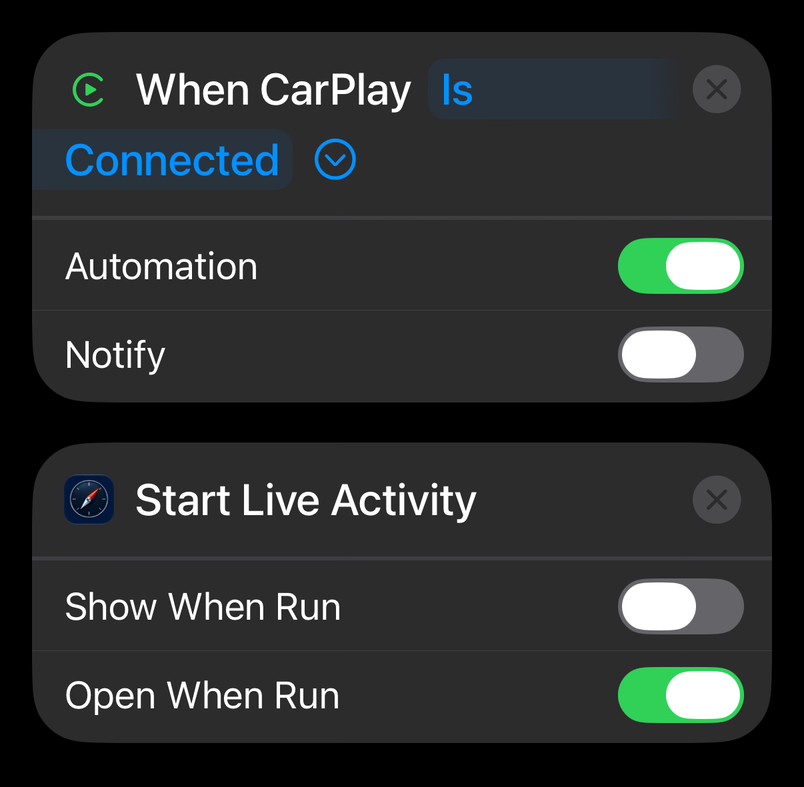
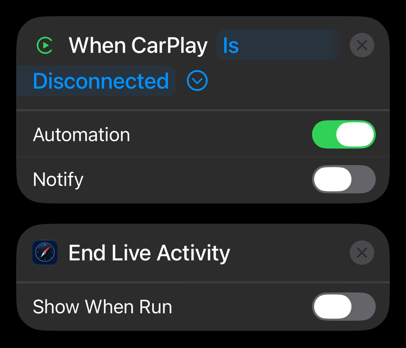

# Live Activity Shortcuts

Compasslet starts its Live Activity when you open it on CarPlay. If the Live Activity
doesn't start on your drives, these two shortcuts start it when CarPlay connects and end it
when CarPlay disconnects. You don't need to unlock your iPhone or open Compasslet.

Install Compasslet before you add the shortcuts.

[Download Start Compass](downloads/start-compass.shortcut){ .md-button .md-button--primary download="Start Compass.shortcut" }
[Download End Compass](downloads/end-compass.shortcut){ .md-button download="End Compass.shortcut" }

Start Compass runs Compasslet's Start Live Activity action, and End Compass runs its End
Live Activity action.

## Add the Shortcuts

1. On your iPhone, open this page in Safari and tap **Download Start Compass**.
2. If Safari asks whether to download the file, tap **Download**, then open it from
   Downloads in Safari or in the Files app.
3. The Shortcuts app opens and shows the shortcut. Tap **Add Shortcut**.
4. Repeat these steps for **Download End Compass**.

## Run Them with CarPlay

Each shortcut comes with its CarPlay automation already set up: Start Compass runs when
CarPlay connects, and End Compass runs when it disconnects. The automations arrive turned
off, so turn them on:

1. In the Shortcuts app, tap **Automation**. If you don't see it, tap the Back button first.
2. Start Compass and End Compass are in the list, turned off. If you don't see them, tap the
   Filter button and choose **Turned Off**. Tap **Start Compass** and turn its automation on.
3. So it runs while your iPhone is locked, go back to your shortcuts, tap **Start Compass**,
   tap **Edit**, tap the Info button, tap **Privacy**, then turn on **Allow Running When
   Locked**.
4. Repeat these steps for **End Compass**.

Automations stay on the iPhone where you turn them on, so repeat these steps on each iPhone
you drive with.

## Make Your Own

If you'd rather make the automations yourself, create two in the Shortcuts app instead of
downloading them:

- **Start:** when CarPlay **Is Connected**, run Compasslet's **Start Live Activity**.
- **End:** when CarPlay **Is Disconnected**, run Compasslet's **End Live Activity**.

Match the settings in these samples. Keep **Open When Run** on for Start Live Activity, so
Compasslet can ask you to unlock your iPhone if it needs to.

{ width="402" height="394" loading="lazy" }

{ width="402" height="345" loading="lazy" }

## While You Drive

- The Live Activity stays on while CarPlay is connected, whether or not you open Compasslet
  on CarPlay. Dismissing it ends it unless Compasslet is open on CarPlay.
- If your iPhone asks you to unlock it, unlock it when you're parked.
- End Compass is optional. Without it, the Live Activity ends a minute after CarPlay
  disconnects, or after the Auto-Stop time chosen in Compasslet's Settings, and stays on
  through brief disconnects.

If the shortcuts don't help, use the [support form](support.md#get-help).
