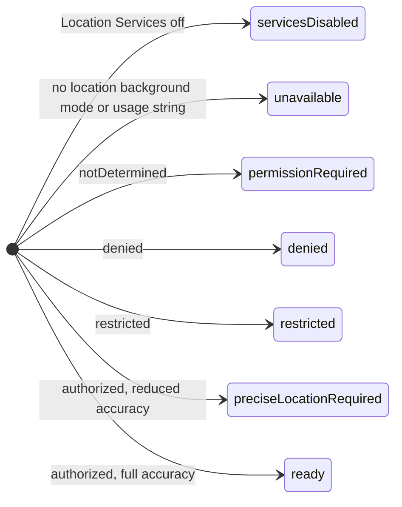
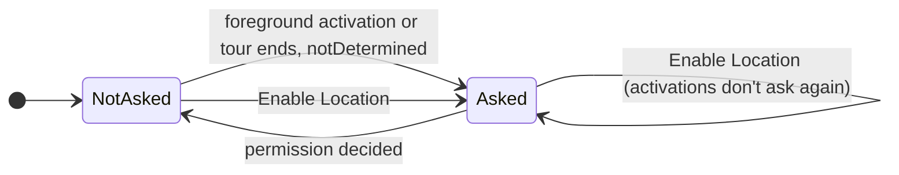
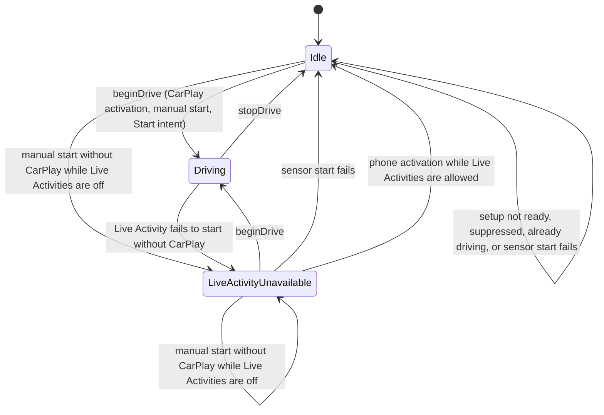
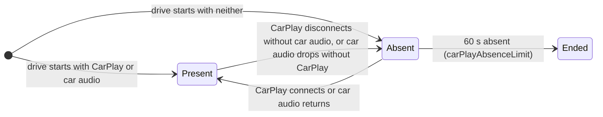
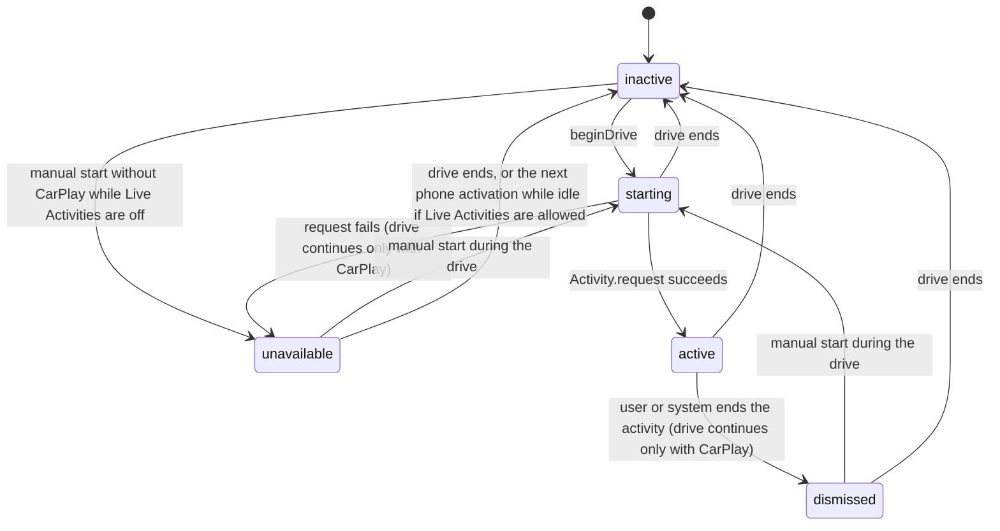
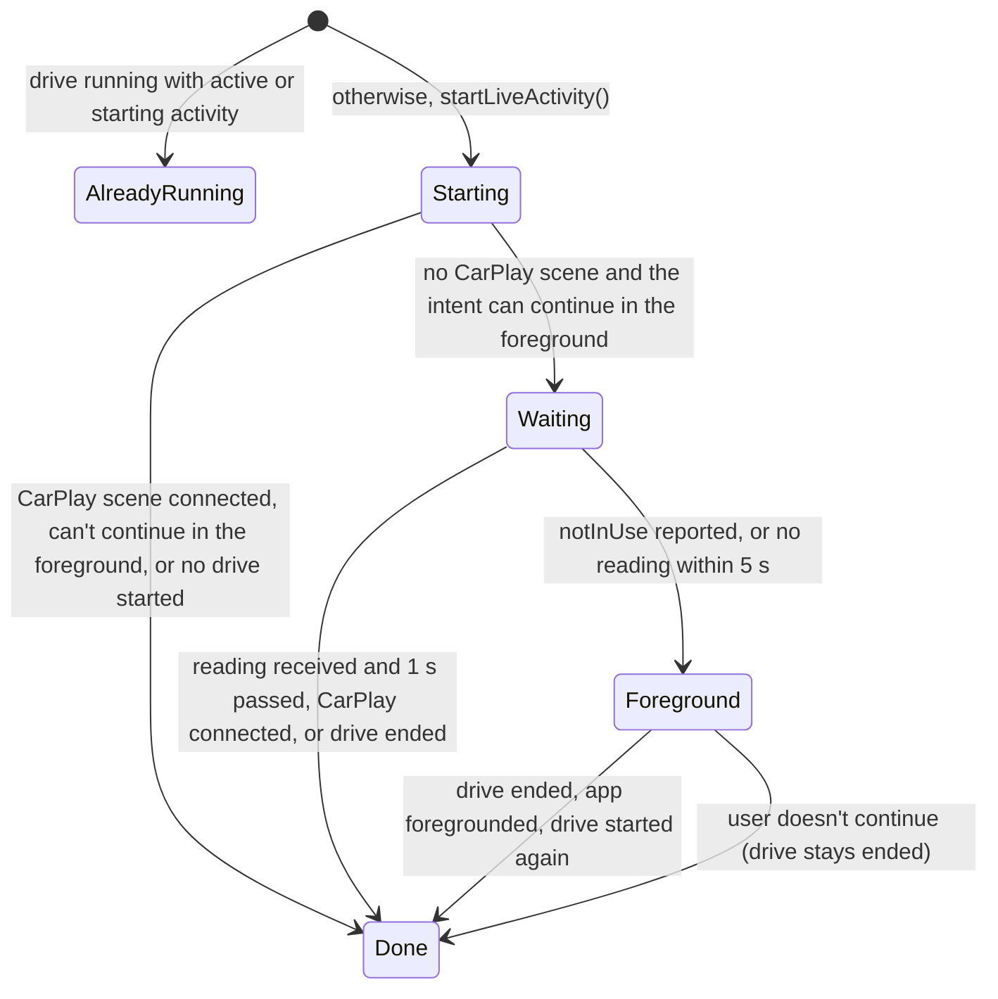
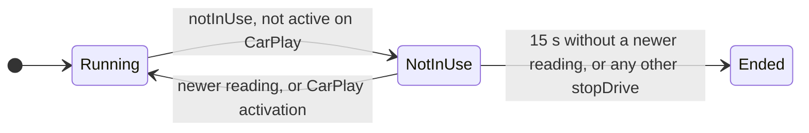
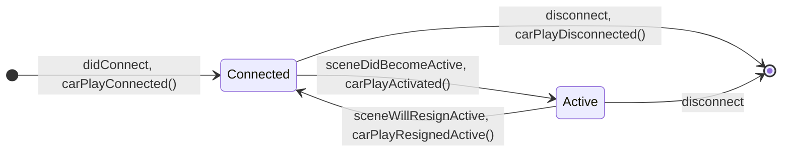
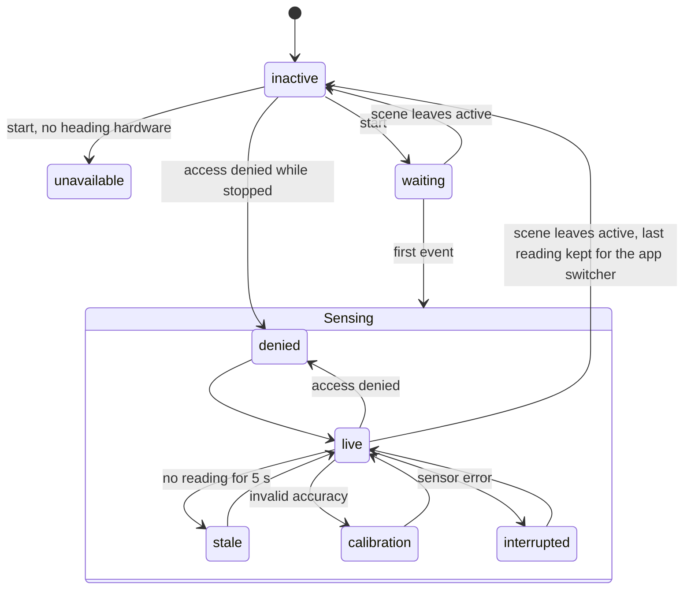

# State Machines

Compasslet has no explicit state machine type. Its behaviour comes from flags, enums,
optionals, tasks and timers spread across a few controllers. This page maps each of those
implicit machines from the code on `main`, so changes can be checked against every state and
transition they touch. File and line references are to commit
[`e9cc6ee`](https://github.com/lunchbox-labs/compasslet/tree/e9cc6ee); search for the named
symbol if lines have moved. [Development](Developer-Development#reading-policies) gives the
reading policies these machines enforce.

Open failure states are listed here and under their machine, each tracked as an issue. None
are open; the three found while mapping these machines are fixed:

- [#247](https://github.com/lunchbox-labs/compasslet/issues/247), fixed by
  [#250](https://github.com/lunchbox-labs/compasslet/pull/250):
  the location prompt was never shown again in the same process.
- [#248](https://github.com/lunchbox-labs/compasslet/issues/248), fixed by
  [#251](https://github.com/lunchbox-labs/compasslet/pull/251):
  a Live Activity outlived a terminated process.
- [#249](https://github.com/lunchbox-labs/compasslet/issues/249), fixed by
  [#252](https://github.com/lunchbox-labs/compasslet/pull/252):
  a background start that lost location after its start window could keep running.

## Overview

One process-lifetime `DriveSessionController` (`CompassAppDelegate.sharedDrive`) is shared by
the phone UI, every CarPlay scene and the App Intents. It owns the drive, the location
eligibility and the Live Activity's lifecycle. The phone compass (`HeadingController`) and
phone location (`PhoneLocationController`) are separate and run only while the phone scene is
active.

| Machine | Owner | Persists across launches |
| --- | --- | --- |
| [Location eligibility](#location-eligibility) | `DriveSessionController.setupStatus` | No (read from Core Location) |
| [Location permission request](#location-permission-request) | `DriveSessionController.requestedPermission` | No |
| [Drive session](#drive-session) | `DriveSessionController.state` | No |
| [Car presence and the absence limit](#car-presence-and-the-absence-limit) | `DriveSessionController` | No |
| [Live Activity lifecycle](#live-activity-lifecycle) | `DriveSession.liveActivity`, `CompassActivityController` | The system activity does |
| [Live Activity content](#live-activity-content) | `CompassActivityController` | The last content state does |
| [Background start intent](#background-start-intent) | `StartLiveActivityIntent` | No |
| [CarPlay scene](#carplay-scene) | `CarPlaySceneDelegate`, `CarPlayLifecycleBridge` | No |
| [CarPlay update gate](#carplay-update-gate) | `CarPlayUpdateGate` | No |
| [Travel course filter](#travel-course-filter) | `TravelCourseFilter` | No |
| [Phone heading](#phone-heading) | `HeadingController` | No |
| [Phone location and city](#phone-location-and-city) | `PhoneLocationController` | No |
| [Welcome tour and tip](#welcome-tour-and-tip) | `OnboardingState` | Yes (`UserDefaults`, TipKit) |
| [Diagnostics](#diagnostics) | `CompassDiagnostics` | Yes (App Group SQLite) |

## Location eligibility

`DriveSessionController.refreshSetupStatus()` (`App/Driving/DriveSessionController.swift:336`)
derives `setupStatus` from Core Location on every call, checked in this order:

It is refreshed at creation, on phone activation, after the permission request, on CarPlay
activation, on a manual start, on each drive heartbeat, on each sensor event, and on
`authorizationChanged` while no drive runs (`observeAuthorization`). Any state other than
`ready` ends a running drive (`phoneBecameActive`, `beat` and `receive`).
`beginDrive` sets `unavailable` directly when the sensor refuses to start, leaves the drive
plainly idle and clears the sensor callback without restoring
the authorization observer. The next refresh replaces the status. This can't happen in
practice, because the sensor checks the same conditions the refresh checked just before.

## Location permission request

The When In Use prompt is asked for only while `setupStatus == .permissionRequired` and the
status is `notDetermined` (`askForLocationPermission`, line 111). `requestedPermission` records
that it was asked for in the current undecided period, and every refresh clears it once the
status is decided (line 337), so a later return to `notDetermined` (an Allow Once grant ending,
or the user choosing Ask Next Time in Settings) can ask again.

Phone activation asks through `requestPhoneAuthorization` (line 104): only in the foreground,
never while the welcome tour is showing (`CompassView.swift:164` and `:186`), and not when it
already asked in this period, so the inactive and active phases the prompt itself causes don't
ask twice. Enable Location, on the main screen's location notice or in the Settings sheet, asks
directly, even after a prompt that closed without an answer.

## Drive session

A drive is the period in which travel location runs. `DriveSessionController.state`
(`App/Driving/DriveSessionController.swift`) holds it as one value: `idle`, recording in
`liveActivityFailed` whether the last start ended because its Live Activity couldn't start,
or `driving` with one `DriveSession` object.
The session holds everything that belongs to one drive: `startedAt`, the course filter, the
last reading, `hasReceivedReading`, `locationNeedsForeground`, `carAbsentSince`,
`notInUseSince`, the background time held for that wait, its heartbeat and deadline timers, and
the drive's Live Activity status. Every sensor callback, timer and Live Activity callback holds
the session it was made for and does nothing once `session === current` fails, so nothing from
an earlier drive reaches the next one. State that spans drives stays on the controller:
`active`, `suppressed`, `requestedPermission`, `setupStatus`, the CarPlay and car audio flags
and `preparation`.

`Idle` and `LiveActivityUnavailable` are `idle(liveActivityFailed: false)` and
`idle(liveActivityFailed: true)`. A sensor start failure needs no state of its own: it shows
as `setupStatus == .unavailable`, and `compactStatus` is `inactive` either way.

Inside a drive, each reading is classified on its own by the
[travel course filter](#travel-course-filter), so the presentation moves between any of these
statuses in any order:

| Status | When |
| --- | --- |
| `waiting` | The drive has started and no reading has been classified yet |
| `usable` | Valid course, speed and accuracy |
| `slow` | Speed under 2 m/s, invalid speed accuracy, or speed minus its accuracy under 1 m/s |
| `unreliable` | Invalid course, course accuracy over 30°, or horizontal accuracy over 50 m |
| `unavailable` | Missing, old or future reading; the last reading over 5 s old (`readingLifetime`, `expireReading`); or a location interruption |

Entry (`beginDrive`) starts a new location manager and background activity session, reads the
car audio route, sets the presentation to `waiting`, starts the 1 s heartbeat, sets the
deadline timer and starts the Live Activity.

`stopDrive` runs on any of:

- setup leaving `ready`, from a refresh, a sensor event or `authorizationLost`;
- eight hours since `startedAt`, or a clock that moved backwards (`driveLimit`, `beat`);
- the car absence limit (`endsAtLimit`, see below);
- location reporting `notInUse` while Compasslet isn't active on CarPlay, with no newer
  reading within 15 s (`notInUseLimit`, `endsAtLimit`; see
  [Background start intent](#background-start-intent));
- an explicit end from the phone button, the End intent or the Start intent's foreground
  retry (`endDrive`);
- a Live Activity dismissal or failed start while Compasslet's CarPlay scene isn't connected
  (`startActivity`).

It replaces the session with `idle`, cancels the session's timers, stops the sensor, restores
the authorization observer and queues `activity.end()`. Background time held for the
not-in-use wait is released only after the activity has ended.

`suppressed` is set when a drive is ended while the CarPlay scene is active, so the same
activation doesn't restart it. It clears when the scene resigns or disconnects. Whenever
setup is `ready` and no drive runs, CarPlay shows "Drive ended. Reopen Compasslet on CarPlay to
start." (`CarPlayPresentation.swift:27`), whether the drive was ended, suppressed or never
started. A new drive starts on the next scene activation, the phone's Live Activity button or
the Start intent; permission returning alone never starts one.

Time comes from an injected `DriveClock` (`SystemDriveClock` in the app). Two kinds of timer
run while a drive does, both in process, so they only advance while the process runs:

- The heartbeat (`heartbeatInterval`, `beat`) runs once a second. It re-reads the car audio
  route, refreshes setup, enforces the eight-hour limit, observes the `activity` diagnostics
  surface (which counts a gap over 2 s as a new session), lets an active Live Activity renew
  its stale date once it has gone 60 s without a write, and checks every limit again. Each
  beat sets the next one an interval after it ran (`scheduleHeartbeat`), so beats are never
  under 1 s apart, which diagnostics would skip, and a late beat brings no burst of catch-up
  beats.
- One deadline timer (`armDeadline`, `deadlineCame`) fires at the first moment past the
  earliest of the absence limit, the not-in-use limit and the reading's 5 s lifetime, so each
  takes effect on time rather than at the next heartbeat. A change that moves a limit later
  leaves the earlier timer, which sets the next one when it fires; a clock already before a
  limit's start makes it due at once.

## Car presence and the absence limit

Two signals show the car: Compasslet's CarPlay scene (`isCarPlayConnected`) and the iPhone
audio route going to CarPlay (`isCarAudioConnected`, from `CarAudioRouteMonitor` and re-read on
every heartbeat in `beat`). A drive started from a CarPlay automation may only ever see the
audio route.

`Absent` is `DriveSession.carAbsentSince != nil`. The deadline timer ends the drive at the first
moment past 60 s, and every heartbeat checks it too.

## Live Activity lifecycle

The drive's view of its Live Activity is `DriveSession.liveActivity`, a
`DriveSessionController.LiveActivityStatus`: `starting`, `active`, `dismissed` or
`unavailable`. With no drive there is no status, so a drive-less `starting` can't be
represented. `compactStatus` and `isLiveActivityRunning` are computed from `state`:
`compactStatus` is `inactive` when idle, `unavailable` after a Live Activity start failed
without CarPlay, and otherwise the drive's status. `isLiveActivityRunning` is true while a
drive runs with its activity `starting` or `active`; the phone's Live Activity button reads it.

`CompassActivityController` holds the system activity's `handle`, a `starting` flag and its
own `generation`. Its `start()`, `end()`, content writes and rewrites all run in order on its
one queue (`operation`, `enqueue`), each joining it when it is called, so a start always
follows the survivor cleanup or an earlier end, and an end always follows queued writes. An
end called while a request waits in the queue or is in flight overtakes it: a waiting request
is never made, a request in flight has its result ended, and either way `start()` throws
`cancelled`.

Activities left from an earlier process are ended by `prepare()`, once per process, before the
first drive, phone activation or intent. `end()` also ends every surviving activity
(`LocalCompassActivitySystem.endSurvivors`). The End intent reports a surviving activity as
ended, not as not running (`hasLiveActivity`).

Every write sets a stale date 5 minutes ahead (`staleInterval`, `stamped`). While the drive's
status is `active`, each heartbeat calls `renew()`, which rewrites the last content once
nothing has been written for 60 seconds. When the process is terminated during a drive (force
quit, crash or memory pressure), nothing renews the activity, so the system marks it stale
within 5 minutes and the card shows travel as unavailable instead of the last direction. It
stays until the app next launches, the End shortcut runs, or ActivityKit's own limit ends it.

## Live Activity content

While the drive's status is `starting` or `active`, it hands each presentation to the
controller with `show` and each location interruption with `invalidateReading`. The controller
keeps only the newest presentation not yet written and a clear that stays pending until it is
written; a clear also drops a presentation handed over before it and the rewrites queued before
it. One queued drain (`drain`) writes the clear first and then the latest presentation, again
whenever more arrives during a write, and only while an activity shows. A successful start
drains what was handed over during the request. `CompassActivityController.write` decides what
reaches the card:

- a usable reading is written only when its rounded degrees or cardinal point change, and at
  most once a second (`changedReadingInterval`);
- while a reading is retained (`scheduledReading`), slow, unreliable, unavailable or expired
  input leaves the card unchanged, so the last direction and its sample time stay visible
  through stops;
- `invalidateReading()` after a location interruption clears the retained reading and shows
  unavailable;
- `waiting` is always written.

`validity` and the queue's `generation` drop queued rewrites that a later clear, dismissal or
end has overtaken. Appearance changes and stale-date renewals rewrite the last content with a new
stale date without changing its sample time. The controller follows the Live Activity's
appearance through `Observations` on `AppearanceStore.preferences` (`appearanceObservation`),
which delivers a change after the change itself, coalesces quick ones and skips values equal to
the last one it applied.

## Background start intent

`StartLiveActivityIntent` (`CompassLiveActivityIntents.swift:8`) can run in the background,
where When In Use location may not start. Its decisions, and those of `EndLiveActivityIntent`,
live in `LiveActivityShortcut` (`CompassLiveActivityIntents.swift`), which works on any
`ShortcutDrive`, so `LiveActivityShortcutTests` covers the intents' decisions without
ActivityKit or location. `DriveSessionControllerTests` covers the `Waiting` state.

`needsForegroundStart` (`DriveSessionController.swift`) is the `Waiting` state. It waits for
the drive to change (`nextChange`, woken by `signalChange` on each sensor event, CarPlay
connection and drive end), for the second after a reading, or for the timeout, rather than
polling. A cancelled wait reports that no foreground start is needed. Its result is the only
consumer of `locationNeedsForeground`.

Any `notInUse` report while Compasslet isn't active on CarPlay starts a wait
(`DriveSession.notInUseSince`, in `receive`). During `Waiting` the intent ends the drive first;
after `Waiting` has settled, or when it was skipped, the wait is what ends it. A reading taken
after the report or CarPlay activation (`clearNotInUse`) clears it; otherwise the deadline
timer ends the drive at the first moment past 15 seconds after the report. The drive holds
background time from the report until the wait clears or the drive's Live Activity has ended,
so suspension can't stop the timer first.

## CarPlay scene

`CarPlaySceneDelegate` maps scene callbacks to the drive through `CarPlayLifecycleBridge`,
whose `generation` drops an activation that a resign has overtaken.

Activation starts a drive when setup is `ready`, no drive runs and the scene isn't suppressed.
Connection alone doesn't start one. Disconnect is reached from either
`sceneDidDisconnect` or `didDisconnectInterfaceController`; the second call finds no bridge.

## CarPlay update gate

`CarPlayUpdateGate` (`CarPlayPresentation.swift:57`) shows a new bearing at most every 10
seconds. Changes without a bearing (status text, drive ended) pass at the next render, so a
status can replace a bearing within the slot, and the next bearing then waits for the slot to
end. `CarPlaySceneDelegate.render` runs every 250 ms while the scene is connected, which is
the only way drive changes reach the template, so one shows about 250 ms after it happens.

## Travel course filter

`TravelCourseFilter.update` (`Sources/CompassCore/TravelCourse.swift:69`) maps each reading to
`usable`, `slow`, `unreliable` or `unavailable`. Any rejection resets the smoother; a
non-increasing timestamp starts a new smoothing sequence.

## Phone heading

`HeadingController` (`Shared/HeadingController.swift`) runs while the phone scene is active.

The first event after `waiting` can lead to any state inside `Sensing`. When the scene leaves
active, only `waiting` and `live` become `inactive` (a `live` reading older than 5 s becomes
`stale` first); `stale`, `calibration`, `interrupted`, `denied` and `unavailable` keep their
status while stopped, and the next start resets to `waiting`.

Under Reduce Motion with the dial kept, readings within 4 degrees of the shown one keep the
shown angle.

`HeadingController.hasSample` (`Shared/HeadingController.swift`) is derived from `sample` and
changes only when a reading appears or clears, and `status` is set only when it changes. The
phone screen's layout reads those two, so only the dial, readout and accuracy views in
`App/Heading/CompassView.swift`, which read `sample`, redraw at the heading rate.

## Phone location and city

`PhoneLocationController` (`App/Heading/PhoneLocationController.swift`) acquires while active,
authorized and services are on. With approximate access it still acquires but discards every
fix and shows the approximate state. Fixes older than 30 seconds or less accurate than 100 m
are cleared. The city lookup runs at most once a minute: after 500 m of movement, while there
is no city yet, or every 10 minutes. A result is dropped if the fix has since moved 500 m or
been cleared.

## Welcome tour and tip

`OnboardingState` (`App/Onboarding/OnboardingState.swift`) steps through `compass`,
`liveActivity` and `shortcuts`. Finishing or skipping stores `onboarding.tourCompleted`; a
tour interrupted by termination starts again on the next launch. Replay from Settings starts at
`compass` and gives the Live Activity button tip a new identifier, because TipKit can't reset
one tip. The location prompt waits until the tour ends.

## Diagnostics

`CompassDiagnostics` (`Shared/CompassDiagnostics.swift`) is off by default. Turning it off
erases all events. While on, each surface (`activity`, `fullscreen`) has a clock that is active
or paused; gaps over 2 seconds and process changes start a new session rather than adding time.
Events are kept for 30 active minutes per surface, up to 50,000. `shared` is created once per
process; if the App Group container can't be opened then, diagnostics stay unavailable until
relaunch. The export is a temporary file removed when its share sheet closes or Debug Mode is
turned off.
