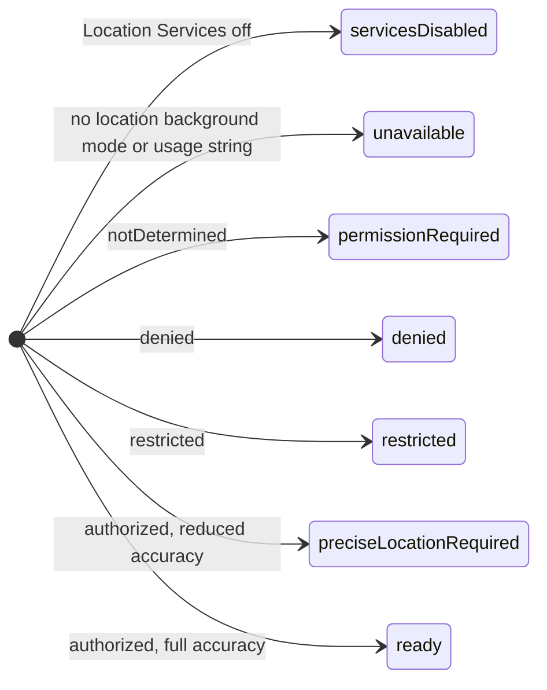
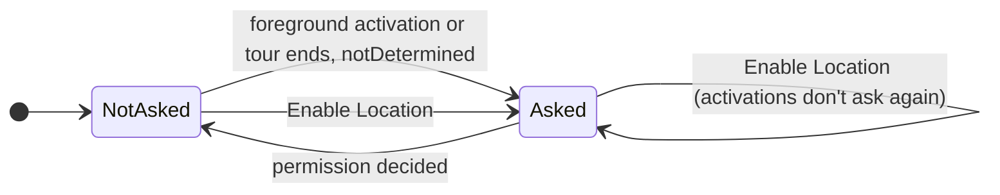
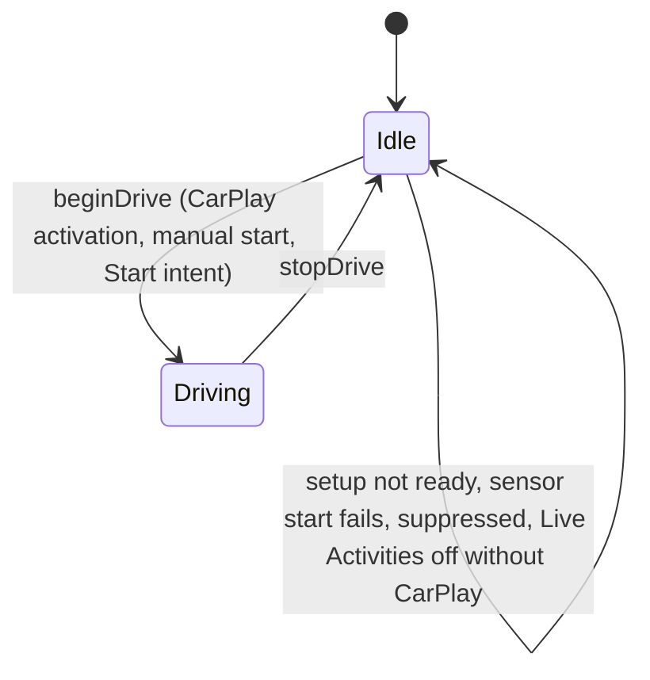
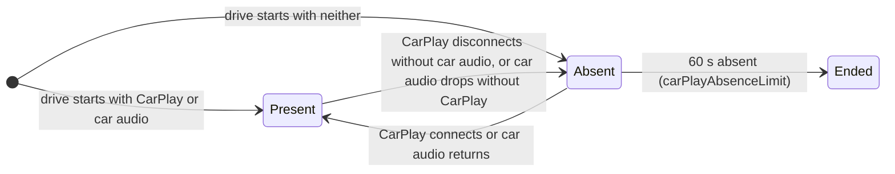
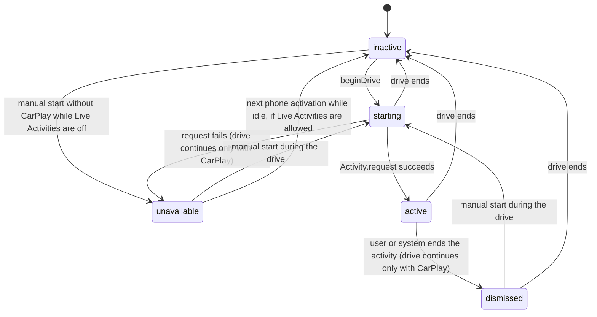
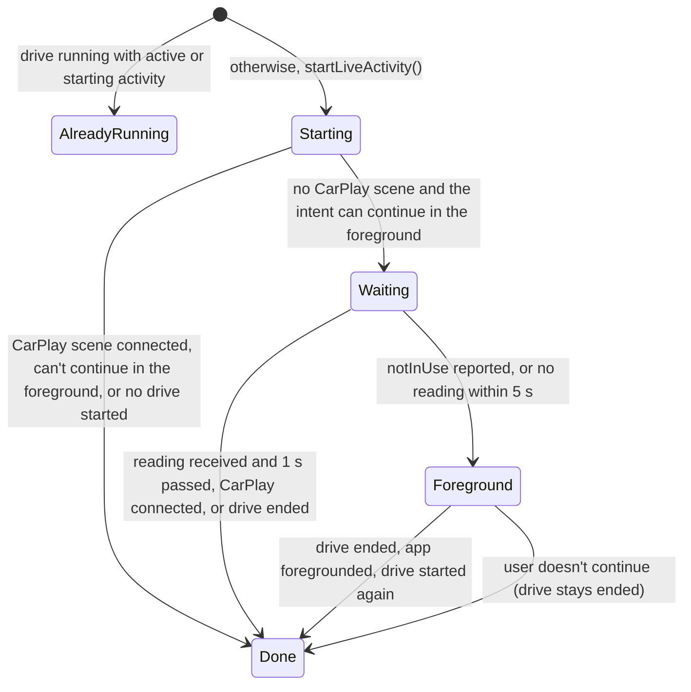
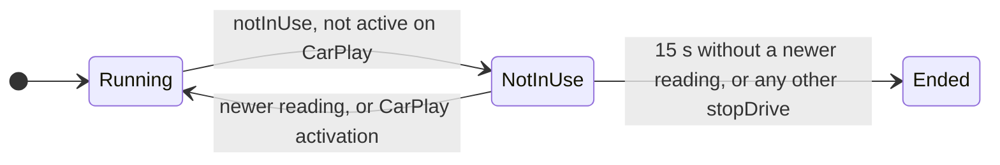
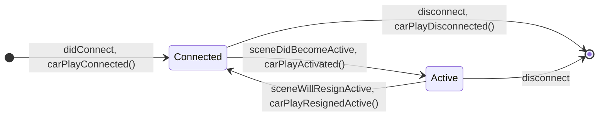
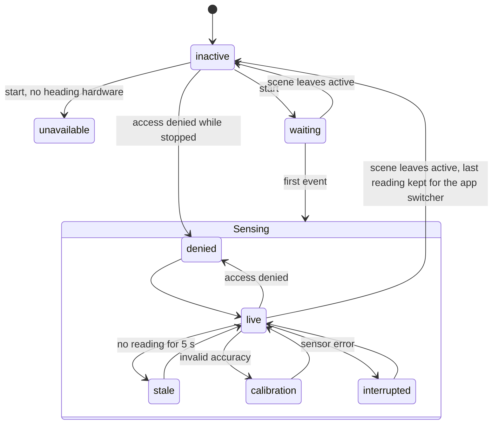

# State Machines

Compasslet has no explicit state machine type. Its behaviour comes from flags, enums,
optionals, tasks and timers spread across a few controllers. This page maps each of those
implicit machines from the code on `main`, so changes can be checked against every state and
transition they touch. File and line references are to commit
[`e9cc6ee`](https://github.com/lunchbox-labs/compasslet/tree/e9cc6ee); search for the named
symbol if lines have moved. [Development](Developer-Development#reading-policies) gives the
reading policies these machines enforce.

Open failure states are listed here and under their machine, each tracked as an issue. None
are open; the three found while mapping these machines are fixed:

- [#247](https://github.com/lunchbox-labs/compasslet/issues/247), fixed by
  [#250](https://github.com/lunchbox-labs/compasslet/pull/250):
  the location prompt was never shown again in the same process.
- [#248](https://github.com/lunchbox-labs/compasslet/issues/248), fixed by
  [#251](https://github.com/lunchbox-labs/compasslet/pull/251):
  a Live Activity outlived a terminated process.
- [#249](https://github.com/lunchbox-labs/compasslet/issues/249), fixed by
  [#252](https://github.com/lunchbox-labs/compasslet/pull/252):
  a background start that lost location after its start window could keep running.

## Overview

One process-lifetime `DriveSessionController` (`CompassAppDelegate.sharedDrive`) is shared by
the phone UI, every CarPlay scene and the App Intents. It owns the drive, the location
eligibility and the Live Activity's lifecycle. The phone compass (`HeadingController`) and
phone location (`PhoneLocationController`) are separate and run only while the phone scene is
active.

| Machine | Owner | Persists across launches |
| --- | --- | --- |
| [Location eligibility](#location-eligibility) | `DriveSessionController.setupStatus` | No (read from Core Location) |
| [Location permission request](#location-permission-request) | `DriveSessionController.requestedPermission` | No |
| [Drive session](#drive-session) | `DriveSessionController` | No |
| [Car presence and the absence limit](#car-presence-and-the-absence-limit) | `DriveSessionController` | No |
| [Live Activity lifecycle](#live-activity-lifecycle) | `compactStatus`, `CompassActivityController` | The system activity does |
| [Live Activity content](#live-activity-content) | `CompassActivityController` | The last content state does |
| [Background start intent](#background-start-intent) | `StartLiveActivityIntent` | No |
| [CarPlay scene](#carplay-scene) | `CarPlaySceneDelegate`, `CarPlayLifecycleBridge` | No |
| [CarPlay update gate](#carplay-update-gate) | `CarPlayUpdateGate` | No |
| [Travel course filter](#travel-course-filter) | `TravelCourseFilter` | No |
| [Phone heading](#phone-heading) | `HeadingController` | No |
| [Phone location and city](#phone-location-and-city) | `PhoneLocationController` | No |
| [Welcome tour and tip](#welcome-tour-and-tip) | `OnboardingState` | Yes (`UserDefaults`, TipKit) |
| [Diagnostics](#diagnostics) | `CompassDiagnostics` | Yes (App Group SQLite) |

## Location eligibility

`DriveSessionController.refreshSetupStatus()` (`App/Driving/DriveSessionController.swift:336`)
derives `setupStatus` from Core Location on every call, checked in this order:

It is refreshed at creation, on phone activation, after the permission request, on CarPlay
activation, on a manual start, on each drive tick, on each sensor event, and on
`authorizationChanged` while no drive runs (`observeAuthorization`, line 330). Any state other
than `ready` ends a running drive (lines 94, 275 and 358).
`beginDrive` sets `unavailable` directly when the sensor refuses to start (line 185) and clears
the sensor callback without restoring the authorization observer. The next refresh replaces
the status. This can't happen in practice, because the sensor checks the same conditions the
refresh checked just before.

## Location permission request

The When In Use prompt is asked for only while `setupStatus == .permissionRequired` and the
status is `notDetermined` (`askForLocationPermission`, line 111). `requestedPermission` records
that it was asked for in the current undecided period, and every refresh clears it once the
status is decided (line 337), so a later return to `notDetermined` (an Allow Once grant ending,
or the user choosing Ask Next Time in Settings) can ask again.

Phone activation asks through `requestPhoneAuthorization` (line 104): only in the foreground,
never while the welcome tour is showing (`CompassView.swift:164` and `:186`), and not when it
already asked in this period, so the inactive and active phases the prompt itself causes don't
ask twice. Enable Location, on the main screen's location notice or in the Settings sheet, asks
directly, even after a prompt that closed without an answer.

## Drive session

A drive is the period in which travel location runs. It is held in `isDriving`, a
`generation` token that invalidates callbacks from earlier drives, `startedAt`, the ticker task
and the sensor callback.

Inside a drive, each reading is classified on its own by the
[travel course filter](#travel-course-filter), so the presentation moves between any of these
statuses in any order:

| Status | When |
| --- | --- |
| `waiting` | The drive has started and no reading has been classified yet |
| `usable` | Valid course, speed and accuracy |
| `slow` | Speed under 2 m/s, invalid speed accuracy, or speed minus its accuracy under 1 m/s |
| `unreliable` | Invalid course, course accuracy over 30°, or horizontal accuracy over 50 m |
| `unavailable` | Missing, old or future reading; the last reading over 5 s old (tick, line 296); or a location interruption |

Entry (`beginDrive`, line 178) starts a new location manager and background activity session,
reads the car audio route, resets the filter, sets the presentation to `waiting`, starts the
250 ms ticker and starts the Live Activity.

`stopDrive` (line 415) runs on any of:

- setup leaving `ready`, from a refresh, a sensor event or `authorizationLost`;
- eight hours since `startedAt`, or a clock that moved backwards (line 275);
- the car absence limit (line 279, see below);
- location reporting `notInUse` while Compasslet isn't active on CarPlay, with no newer
  reading within 15 s (`notInUseLimit`, line 286; see
  [Background start intent](#background-start-intent));
- an explicit end from the phone button, the End intent or the Start intent's foreground
  retry (`endDrive`, line 257);
- a Live Activity dismissal or failed start while Compasslet's CarPlay scene isn't connected
  (lines 212 and 234).

It bumps `generation`, cancels the ticker, stops the sensor, restores the authorization
observer, clears every reading and the not-in-use wait, and queues `activity.end()`. Background
time held for that wait is released only after the activity has ended.

`suppressed` (line 49) is set when a drive is ended while the CarPlay scene is active, so the
same activation doesn't restart it. It clears when the scene resigns or disconnects. Whenever
setup is `ready` and no drive runs, CarPlay shows "Drive ended. Reopen Compasslet on CarPlay to
start." (`CarPlayPresentation.swift:27`), whether the drive was ended, suppressed or never
started. A new drive starts on the next scene activation, the phone's Live Activity button or
the Start intent; permission returning alone never starts one.

The ticker is an in-process `Task.sleep` loop, so the eight-hour limit, the absence limit, the
not-in-use limit and the five-second reading expiry only advance while the process is running.
Each tick also lets an active Live Activity renew its stale date once it has gone 60 s without
a write (line 295).

## Car presence and the absence limit

Two signals show the car: Compasslet's CarPlay scene (`isCarPlayConnected`) and the iPhone
audio route going to CarPlay (`isCarAudioConnected`, from `CarAudioRouteMonitor` and polled on
every tick at line 271). A drive started from a CarPlay automation may only ever see the audio
route.

`Absent` is `carPlayAbsentSince != nil`; the limit is checked on the tick.

## Live Activity lifecycle

The drive's view of its Live Activity is `compactStatus` (line 15). `CompassActivityController`
holds the system activity's `handle`, a `starting` flag and its own `generation`. All activity
operations run in order on one queue (`enqueue`, line 454), so a start always follows the
survivor cleanup and an end always follows queued updates.

Activities left from an earlier process are ended by `prepare()` (line 82), once per process,
before the first drive, phone activation or intent. `end()` also ends every surviving activity
(`CompassActivityController.swift:239`). The End intent reports a surviving activity as ended,
not as not running (`hasLiveActivity`, line 307).

Every write sets a stale date 5 minutes ahead (`staleInterval`, `stamped`,
`CompassActivityController.swift:246`). While `compactStatus` is `active`, each drive tick
calls `renew()` (`CompassActivityController.swift:187`), which rewrites the last content once
nothing has been written for 60 seconds. When the process is terminated during a drive (force
quit, crash or memory pressure), nothing renews the activity, so the system marks it stale
within 5 minutes and the card shows travel as unavailable instead of the last direction. It
stays until the app next launches, the End shortcut runs, or ActivityKit's own limit ends it.

## Live Activity content

`CompassActivityController.publish` (`CompassActivityController.swift:123`) decides what
reaches the card:

- a usable reading is written only when its rounded degrees or cardinal point change, and at
  most once a second (`changedReadingInterval`);
- while a reading is retained (`scheduledReading`), slow, unreliable, unavailable or expired
  input leaves the card unchanged, so the last direction and its sample time stay visible
  through stops;
- `invalidateReading()` after a location interruption clears the retained reading and shows
  unavailable;
- `waiting` is always written.

`validity` and the queue's `generation` drop queued writes that a later clear or end has
overtaken. Appearance changes and stale-date renewals rewrite the last content with a new
stale date without changing its sample time.

## Background start intent

`StartLiveActivityIntent` (`CompassLiveActivityIntents.swift:8`) can run in the background,
where When In Use location may not start. Its decisions, and those of `EndLiveActivityIntent`,
live in `LiveActivityShortcut` (`CompassLiveActivityIntents.swift`), which works on any
`ShortcutDrive`, so `LiveActivityShortcutTests` covers the intents' decisions without
ActivityKit or location. `DriveSessionControllerTests` covers the `Waiting` state.

`needsForegroundStart` (`DriveSessionController.swift:312`) is the `Waiting` state. Its result
is the only consumer of `locationNeedsForeground`.

Any `notInUse` report while Compasslet isn't active on CarPlay starts a wait (`notInUseSince`,
line 368). During `Waiting` the intent ends the drive first; after `Waiting` has settled, or
when it was skipped, the wait is what ends it. A reading taken after the report (line 379) or
CarPlay activation (line 141) clears it; otherwise the tick ends the drive 15 seconds after the
report. The drive holds background time from the report until the wait clears or the drive's
Live Activity has ended, so suspension can't stop the tick first.

## CarPlay scene

`CarPlaySceneDelegate` maps scene callbacks to the drive through `CarPlayLifecycleBridge`,
whose `generation` drops an activation that a resign has overtaken.

Activation starts a drive when setup is `ready`, no drive runs and the scene isn't suppressed.
Connection alone doesn't start one. Disconnect is reached from either
`sceneDidDisconnect` or `didDisconnectInterfaceController`; the second call finds no bridge.

## CarPlay update gate

`CarPlayUpdateGate` (`CarPlayPresentation.swift:57`) shows a new bearing at most every 10
seconds. Changes without a bearing (status text, drive ended) pass immediately, so a status can
replace a bearing within the slot, and the next bearing then waits for the slot to end.

## Travel course filter

`TravelCourseFilter.update` (`Sources/CompassCore/TravelCourse.swift:69`) maps each reading to
`usable`, `slow`, `unreliable` or `unavailable`. Any rejection resets the smoother; a
non-increasing timestamp starts a new smoothing sequence.

## Phone heading

`HeadingController` (`Shared/HeadingController.swift`) runs while the phone scene is active.

The first event after `waiting` can lead to any state inside `Sensing`. When the scene leaves
active, only `waiting` and `live` become `inactive` (a `live` reading older than 5 s becomes
`stale` first); `stale`, `calibration`, `interrupted`, `denied` and `unavailable` keep their
status while stopped, and the next start resets to `waiting`.

Under Reduce Motion with the dial kept, readings within 4 degrees of the shown one keep the
shown angle.

## Phone location and city

`PhoneLocationController` (`App/Heading/PhoneLocationController.swift`) acquires while active,
authorized and services are on. With approximate access it still acquires but discards every
fix and shows the approximate state. Fixes older than 30 seconds or less accurate than 100 m
are cleared. The city lookup runs at most once a minute: after 500 m of movement, while there
is no city yet, or every 10 minutes. A result is dropped if the fix has since moved 500 m or
been cleared.

## Welcome tour and tip

`OnboardingState` (`App/Onboarding/OnboardingState.swift`) steps through `compass`,
`liveActivity` and `shortcuts`. Finishing or skipping stores `onboarding.tourCompleted`; a
tour interrupted by termination starts again on the next launch. Replay from Settings starts at
`compass` and gives the Live Activity button tip a new identifier, because TipKit can't reset
one tip. The location prompt waits until the tour ends.

## Diagnostics

`CompassDiagnostics` (`Shared/CompassDiagnostics.swift`) is off by default. Turning it off
erases all events. While on, each surface (`activity`, `fullscreen`) has a clock that is active
or paused; gaps over 2 seconds and process changes start a new session rather than adding time.
Events are kept for 30 active minutes per surface, up to 50,000. `shared` is created once per
process; if the App Group container can't be opened then, diagnostics stay unavailable until
relaunch. The export is a temporary file removed when its share sheet closes or Debug Mode is
turned off.
